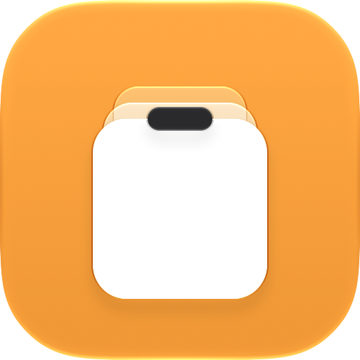
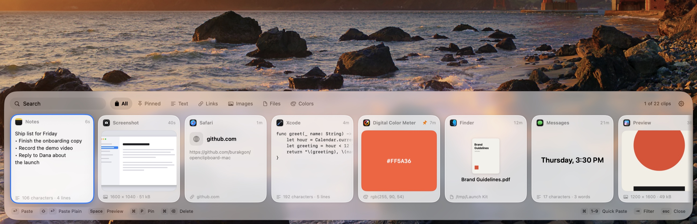
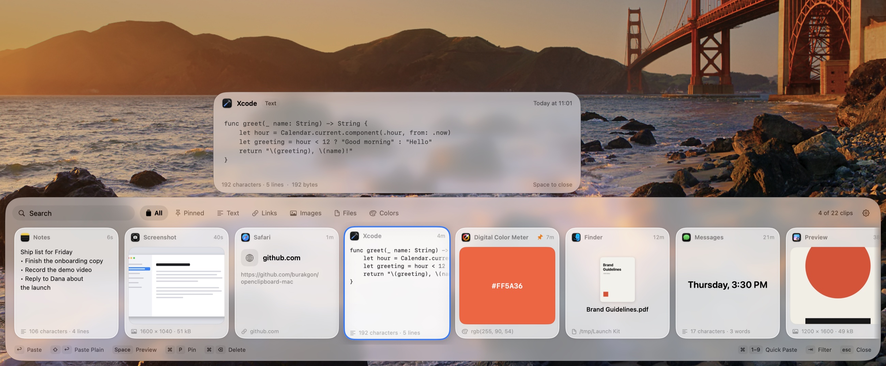
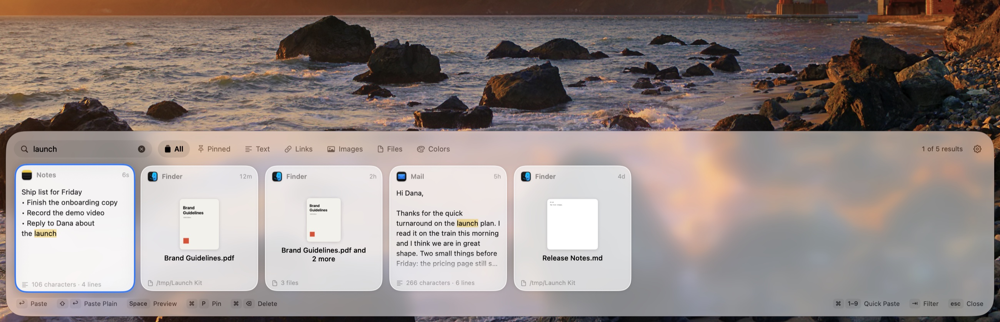
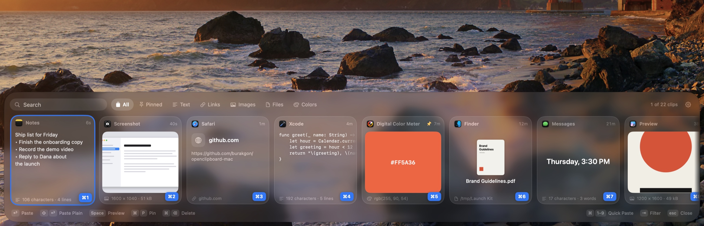
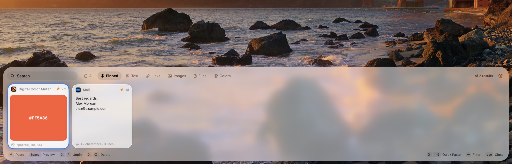

<div align="center">



# OpenClipboard

### Everything you copy, one shortcut away.

A clipboard manager for the Mac that looks and feels like a part of macOS.<br>
**Native Swift. About 25 MB of memory. 0% CPU at rest. No account, no analytics. Free and open source.**

[](https://github.com/burakgon/openclipboard-mac/releases/latest)
[](#install)
[](#install)
[](#how-it-works)
[](https://github.com/burakgon/openclipboard-mac/actions/workflows/ci.yml)
[](LICENSE)

[**Download for macOS**](https://github.com/burakgon/openclipboard-mac/releases/latest/download/OpenClipboard.dmg) · [Features](#features) · [Install](#install) · [Keyboard](#keyboard) · [Privacy](#privacy) · [FAQ](#faq) · [Build it yourself](#build-it-yourself)

<br>

<picture>
  <source media="(prefers-color-scheme: dark)" srcset="docs/images/hero-dark.jpg">
  
</picture>

</div>

<br>

Press <kbd>⇧</kbd><kbd>⌘</kbd><kbd>V</kbd> in any app. Your clipboard history slides up from the bottom of
the screen: the text, links, pictures, files and colors you copied, each on a card you recognize
before you have read a word. Arrow to one, press <kbd>Return</kbd>, and it is pasted right where
you were typing.

## Why

Clipboard managers tend to come in two kinds. The beautiful ones, with a shelf of visual cards, are
subscriptions. The free ones are a plain list in the menu bar.

OpenClipboard is the shelf, as a small native app that costs nothing, is open source, and keeps
what you copy on your Mac. It is built for macOS 26 and later, on Liquid Glass, and it is careful
with your Mac: it waits in the background without using the processor at all.

|                |                                                                                  |
| -------------- | -------------------------------------------------------------------------------- |
| Built with     | Swift 6, SwiftUI and AppKit. No Electron, no web views                            |
| Memory         | about 25 MB after launch, 40 to 50 MB once the shelf has been used                |
| CPU at rest    | 0%. It only looks at a counter twice a second, and sleeps when the display does   |
| Download       | 3 MB                                                                              |
| Remembers      | text, formatted text, code, links, images, files, colors, and apps' own formats   |
| Your history   | one file on your Mac, readable only by your account. No cloud, no account         |
| Price          | free, [MIT license](LICENSE)                                                      |

## Features

### Previews you recognize at a glance

Every kind of clip gets a card made for it: text reads like text, code keeps its indentation in a
monospaced font, a link shows its site, a picture fills its card, a color is a swatch, a file shows
its icon or its Quick Look thumbnail. Each card says which app it came from and when.

Press <kbd>Space</kbd> on any clip to see it large, the way Quick Look works in Finder: the whole
text with its formatting, the picture at full size, a color in HEX, RGB and HSL.

<picture>
  <source media="(prefers-color-scheme: dark)" srcset="docs/images/preview-dark.jpg">
  
</picture>

### Type to search

There is no search box to click: just start typing. Search looks through the text of your clips,
file names and paths, links and the names of the apps you copied from. It ignores case and accents
(<kbd>resume</kbd> finds “Résumé”), every word has to match, and what it found is marked on the cards.
<kbd>Tab</kbd> narrows the shelf to text, links, images, files or colors.



### Paste with one key

<kbd>Return</kbd> pastes the selected clip into the app you were in. Hold <kbd>⌘</kbd> and the cards on
screen show a number: <kbd>⌘</kbd><kbd>1</kbd> to <kbd>⌘</kbd><kbd>9</kbd> paste them without moving the
selection. <kbd>⇧</kbd><kbd>Return</kbd> pastes as plain text, without the fonts and colors of where it
came from. You can also drag a card straight into another app.



### Pin what you keep needing

An address, an IBAN, a snippet, a signature: press <kbd>⌘</kbd><kbd>P</kbd> and the clip is pinned. Pinned
clips have their own filter and are kept until you unpin them. Everything else is tidied away
after a month, or after a day, a week, three months or a year, or never. You choose.



### It pastes back exactly what you copied

A clip is stored in every format the app offered: formatted text keeps its formatting, a table
cell stays a table cell, a shape from a design tool stays a shape. Pictures are kept losslessly but
compactly: a 5K screenshot that takes 59 MB on the pasteboard is stored in a fraction of that.
Copying the same thing twice does not fill the shelf with duplicates; the clip just moves to the
front.

### Careful with your Mac

- **No polling of content.** macOS has no notification for the pasteboard, so every clipboard
  manager has to check a counter. That is all OpenClipboard does while you work: read one number,
  twice a second, with a timer the system is free to merge with other wake-ups. The pasteboard
  itself is only read when the number changed.
- **Nothing happens on the main thread.** Reading, hashing, converting pictures and writing to
  the database all happen in the background, so the shelf never stutters.
- **Thumbnails are made once**, when a picture is copied, and decoded at the size of a card. The
  shelf never loads a full-size image to show a small one.
- **It lets go.** Half a minute after the shelf closes, its cards and pictures are released.
  While the display sleeps, even the counter is not checked.

### And the rest

- Opens on the display you are working on, on every Space, and over apps in full screen.
- A mouse wheel scrolls the shelf sideways. Double-click pastes, right-click has every action.
- Light and dark mode, your accent color, Reduce Transparency and VoiceOver labels.
- Opens at login if you want, and updates itself with [Sparkle](https://sparkle-project.org).
  Every update is signed twice: by Apple's notary service and with the project's own key.

## Install

1. **[Download OpenClipboard.dmg](https://github.com/burakgon/openclipboard-mac/releases/latest/download/OpenClipboard.dmg)**,
   open it and drag OpenClipboard to Applications.
2. Open it. A short welcome shows the shortcut and asks for one permission.
3. Press <kbd>⇧</kbd><kbd>⌘</kbd><kbd>V</kbd> anywhere.

Requires macOS 26 or later, on Apple silicon or Intel. The app is signed with a Developer ID and
notarized by Apple.

**The one permission.** To paste a clip into another app, OpenClipboard has to press
<kbd>⌘</kbd><kbd>V</kbd> for you, and macOS only lets an app do that once you allow it under
*System Settings → Privacy & Security → Accessibility*. The welcome window and the shelf both lead
you there, and the shelf tells you when it worked. You can also say no: choosing a clip then
copies it, and you press <kbd>⌘</kbd><kbd>V</kbd> yourself.

## Keyboard

| Key                                         | What it does                                        |
| ------------------------------------------- | --------------------------------------------------- |
| <kbd>⇧</kbd><kbd>⌘</kbd><kbd>V</kbd>        | Open or close the shelf (you can change it)         |
| <kbd>←</kbd> <kbd>→</kbd>                   | Choose a clip                                       |
| <kbd>Return</kbd>                           | Paste it                                            |
| <kbd>⇧</kbd><kbd>Return</kbd>               | Paste it as plain text (for files: their paths)     |
| <kbd>⌘</kbd><kbd>1</kbd> … <kbd>⌘</kbd><kbd>9</kbd> | Paste the first to ninth clip on screen     |
| <kbd>⌘</kbd><kbd>C</kbd>                    | Copy it without pasting                             |
| <kbd>Space</kbd>                            | Preview it large                                    |
| <kbd>⌘</kbd><kbd>P</kbd>                    | Pin or unpin it                                     |
| <kbd>⌘</kbd><kbd>⌫</kbd>                    | Delete it                                           |
| <kbd>⌘</kbd><kbd>O</kbd>                    | Open the link or the file                           |
| any letters                                 | Search                                              |
| <kbd>Tab</kbd>                              | Next filter: All, Pinned, Text, Links, Images…      |
| <kbd>⌘</kbd><kbd>←</kbd> <kbd>⌘</kbd><kbd>→</kbd> | Jump to the newest or the oldest clip         |
| <kbd>Esc</kbd>                              | Close the preview, clear the search, close the shelf |

The shelf lists the keys that apply to the selected clip along its bottom edge, so there is
nothing to memorize.

## Privacy

A clipboard manager sees everything you copy. This one is built so that you do not have to trust
it more than you can check.

- **Your history stays on your Mac.** It is one SQLite file in
  `~/Library/Application Support/OpenClipboard`, readable only by your user account. There is no
  account, no sync, no analytics and no crash reporting.
- **The only network request** is the check for updates, to GitHub. You can turn it off.
- **Passwords are skipped.** Password managers mark what they copy as secret
  ([nspasteboard.org](http://nspasteboard.org)); OpenClipboard does not record those clips, nor the
  ones apps mark as transient.
- **Ignore any app.** Add an app in Settings → Privacy and nothing copied from it is recorded.
  Or pause recording altogether from the menu bar.
- **It does not look into your files.** For a copied file only its location is kept. Thumbnails
  for files in Desktop, Documents, Downloads and iCloud Drive are off until you turn them on,
  because they would make macOS ask for access to those folders.
- **Deleted means deleted.** Removed clips are overwritten in the database, not just unlinked.
- **It is open source.** Everything above can be read in this repository.

## FAQ

**I double-click a clip, or press Return, and nothing is pasted.**<br>
macOS has not been allowed to let OpenClipboard paste yet. Open the shelf and click the orange
*Allow Pasting…* button, or turn on OpenClipboard under *System Settings → Privacy & Security →
Accessibility*. Without the permission a clip is only copied, and you paste it with
<kbd>⌘</kbd><kbd>V</kbd>.

**⇧⌘V is “Paste and Match Style” in the app I use.**<br>
While OpenClipboard runs, its shortcut wins. Choose another one in Settings → General, or use
<kbd>⇧</kbd><kbd>Return</kbd> in the shelf, which pastes without formatting in every app.

**Where is my history, and can I back it up?**<br>
In `~/Library/Application Support/OpenClipboard/History.sqlite`. Copy the folder while the app is
not running.

**Does it sync between Macs, or with my iPhone?**<br>
No, it has no sync of its own. What Apple's Universal Clipboard brings over from your iPhone or iPad
is recorded like any other copy.

**Why macOS 26 or later?**<br>
The shelf is built on Liquid Glass, which arrived with macOS 26. Supporting older systems would
mean a second interface.

**How do I uninstall it?**<br>
Quit it from the menu bar, move it to the Trash, and delete
`~/Library/Application Support/OpenClipboard` if you want the history gone as well.

**I hid the menu bar icon. How do I get to the settings?**<br>
Open OpenClipboard again from Spotlight or the Applications folder, or press <kbd>⌘</kbd><kbd>,</kbd> in the shelf.

## Build it yourself

You need Xcode 27 or later.

```sh
git clone https://github.com/burakgon/openclipboard-mac.git
cd openclipboard-mac
open OpenClipboard.xcodeproj        # then Run
```

Or from the command line:

```sh
xcodebuild -project OpenClipboard.xcodeproj -scheme OpenClipboard -derivedDataPath build/DerivedData build
swift test --package-path Packages/OpenClipboardKit
```

The app is signed ad hoc by default, so no Apple developer account is needed. To sign with your own
identity, which keeps the Accessibility permission across rebuilds, see the comment in
[`Config/Base.xcconfig`](Config/Base.xcconfig).

To try the interface without recording anything, start the app with `--demo`: it uses sample clips
in a throwaway history and a private pasteboard. The screenshots on this page are made that way,
by [`scripts/screenshots.sh`](scripts/screenshots.sh).

## How it works

```
Packages/OpenClipboardKit     everything that is not user interface, with its tests
  Pasteboard/                   watching the pasteboard, reading a clip, writing it back
  Analysis/                     what is this? text, code, link, color, picture
  Storage/                      the history: SQLite, with no dependency
OpenClipboard                 the app
  Shelf/                        the panel, the cards, the preview
  Settings/, Onboarding/        the windows
  Services/                     the global shortcut, pasting, icons, updates
```

- **The shelf is a non-activating panel.** It takes the keyboard without becoming the active app,
  so the app you were typing in keeps its place, and a clip can be pasted straight back into it.
- **The pasteboard is read in two steps.** First only the names of the types on it, to decide what
  the clip is; then exactly the representations worth keeping. An app is never made to render a
  huge format that would be thrown away.
- **The history is an actor around one SQLite connection.** Rows are small and listed often;
  payloads and thumbnails live in their own tables and are read only when a clip is shown large or
  pasted.
- **The only dependency is [Sparkle](https://sparkle-project.org)**, for updates.

## Contributing

Bug reports and ideas are welcome in the [issues](https://github.com/burakgon/openclipboard-mac/issues).
For code, see [CONTRIBUTING.md](CONTRIBUTING.md).

## License

[MIT](LICENSE). The shelf of cards was made famous by [Paste](https://pasteapp.io); OpenClipboard is
an independent project and shares no code with it.
